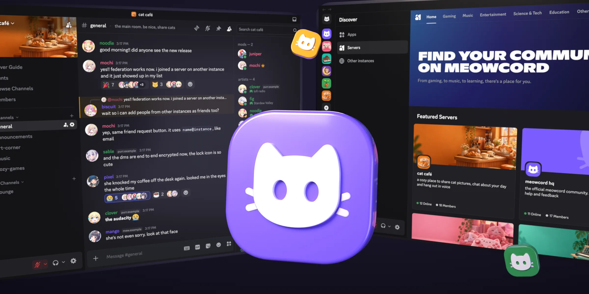

  

<h1 align="center">Meowcord</h1>

meowcord is a self-hosted discord clone aiming for feature parity, with e2e encryption and federation.

it serves a patched copy of the Discord web client with Equicord, rebranded as your instance, so people can sign up and use the real Discord UI without a Discord account.

**meowcord is currently in very early alpha.** right now it's a big mess and only fit for testing. during the alpha we also allow ai contributions, so that as many people as possible can test it and contribute. else, we'd never get anywhere near discord feature parity.

## join meowcord!!

no matter what instance you pick, you can join servers and group chats and add friends on every other verified instance :3

**start by [picking an instance from this list](instances.md) and signing up.** you can find servers to join in the Discovery tab.

## self-hosting

you need a Linux host with Docker, a domain pointing at it and a public IPv4 address for voice. [the setup guide](docs/self-hosting/setup.md) installs it with Docker Compose, and [the native Linux guide](docs/self-hosting/native.md) runs it under systemd instead. [the verification guide](docs/self-hosting/verification.md) gets your instance listed in [instances.md](instances.md) and global discovery, and [docs/README.md](docs/README.md) indexes every other page.

## contributing

read [CONTRIBUTING.MD](CONTRIBUTING.MD) for the conventions and the commands to run before pushing, and open an issue or pull request for bugs and improvements.

## License

AGPL-3.0-only, see [LICENSE](LICENSE). Code inherited from before this fork is by [Spacebar](https://github.com/spacebarchat/server) and its contributors.
